# Guía: Shooter estilo PSX en Unity

Ruta de aprendizaje en 7 fases. Haz cada fase entera antes de pasar a la siguiente:
cada una se apoya en la anterior.

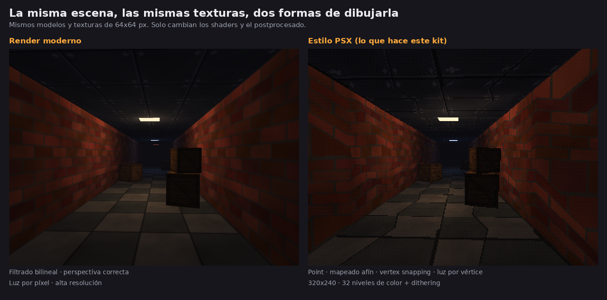

> **Sobre las imágenes:** todas están generadas por `img/generar_imagenes.py`, un pequeño
> rasterizador en Python que aplica **las mismas técnicas que los shaders del kit**
> (snapping, mapeado afín, filtrado Point, luz por vértice, niebla y dithering).
> No son capturas de juegos reales: muestran exactamente lo que vas a programar.

---

## Fase 0 — Entender el estilo PSX

El "look PS1" no es una decisión artística: es lo que pasaba por las **limitaciones del hardware**.
Si entiendes las limitaciones, sabrás imitar el estilo:

| Limitación del hardware | Cómo se ve | Dónde lo imitamos |
|---|---|---|
| Posiciones con números enteros (sin subpíxel) | Vértices que tiemblan | `PSX_Lit.shader` → vertex snapping |
| Sin corrección de perspectiva en UVs | Texturas que se doblan | `PSX_Lit.shader` → mapeado afín |
| Sin filtrado de texturas | Píxeles nítidos | Sampler Point + ajustes de importación |
| 2 MB de VRAM | Texturas de 64–256 px, paletas pequeñas | Texturizado (Fase 3) |
| Luz calculada en los vértices | Luz a manchas, sin sombras | `PSX_Lit.shader` → Gouraud |
| Poco alcance de dibujado | Niebla densa | Niebla de Unity (Lighting) |
| Resolución 320×240, color de 15 bits | Píxeles gordos, dithering | `PSX_PostProcess.shader` |
| Sin Z-buffer | Polígonos que se cruzan mal | (normalmente no se imita) |

Las imágenes de las fases siguientes muestran cada limitación por separado, para que veas qué
aporta cada una.

**Juegos de referencia** para mirar y tomar capturas: Medal of Honor (1999), MediEvil,
Silent Hill, Metal Gear Solid, Alien Trilogy, Quake II (PS1), y modernos como
Dusk, Signalis, Mouthwashing o los juegos de Haunted PS1.

---

## Fase 1 — Proyecto en Unity

1. Unity Hub → **New Project** → plantilla **Universal 3D (URP)** (Unity 6 o 2022.3 LTS).
2. Copia la carpeta `Assets/` de este kit dentro de tu proyecto.
3. En tu asset **Universal Renderer Data** (en `Assets/Settings/`):
   - **Rendering Path → Forward** (el shader PSX lee las luces adicionales de esa forma).
4. En el asset **URP Asset**:
   - Desactiva **HDR** (la PS1 no lo tenía y ahorras rendimiento).
   - **Anti Aliasing (MSAA): Disabled**. El AA borra los bordes duros.
   - Additional Lights: **Per Vertex** (más fiel) o Per Pixel.
5. **Project Settings → Player → Color Space**: Linear vale (el shader de post ya lo compensa).

### Escena de prueba
- Crea un `Plane` (suelo) y unos `Cube`s.
- Crea un material: clic derecho → Create → Material → Shader: **PSX/Lit**. Asígnalo.
- **Window → Rendering → Lighting → Environment**: activa **Fog**, modo Linear o Exponential,
  color gris oscuro. Pon el mismo color de fondo en la cámara (Background Type: Solid Color).

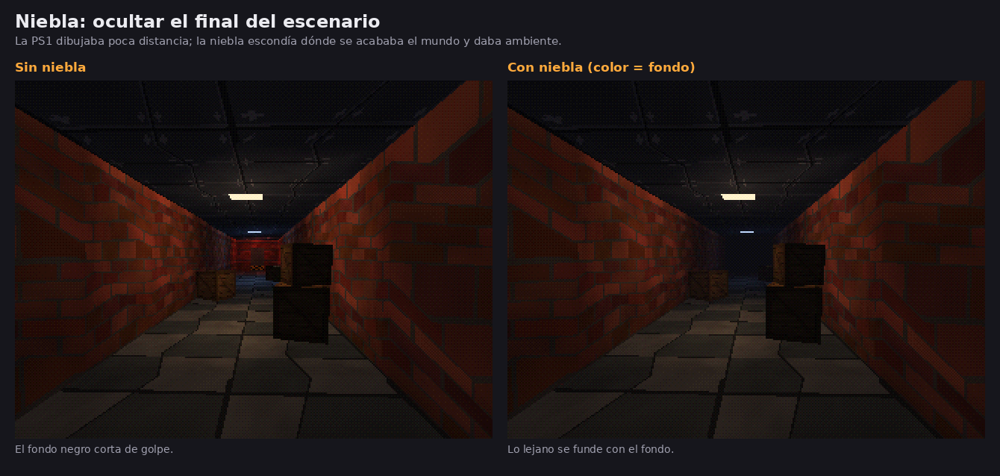

---

## Fase 2 — Modelado (Blender, gratis)

### Reglas del low-poly PSX
- **Presupuesto de polígonos** (triángulos):
  - Personaje/enemigo: 300–800
  - Arma en primera persona: 200–600 (se ve grande, puede tener algo más)
  - Prop pequeño (caja, barril): 12–100
  - Habitación: pocos cientos
- **Silueta primero**: con tan pocos polígonos, lo que se lee es la forma. Bloquea con cubos y
  cilindros de 6–8 lados.

  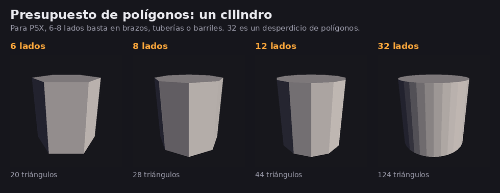

- **Personajes por piezas**: la PS1 animaba muchos personajes como piezas rígidas
  (brazo, antebrazo, mano). Es más fácil de riggear y queda más auténtico.
- **Subdivide los suelos y paredes grandes**: con mapeado afín, un polígono enorme
  se deforma muchísimo. Divide el suelo en una rejilla (p. ej. cuadros de 2×2 m). Esto
  es exactamente lo que hacían los juegos de la época. Fíjate en la tercera imagen:

  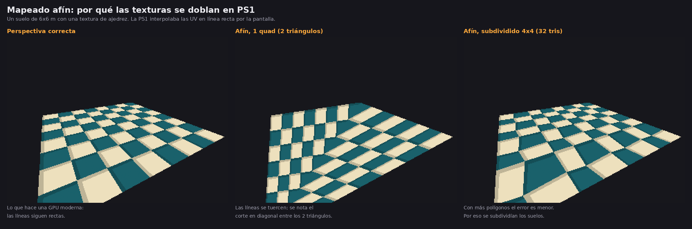

  Subdividir también mejora la luz por vértice (cuantos más vértices, más puntos donde se
  calcula la luz):

  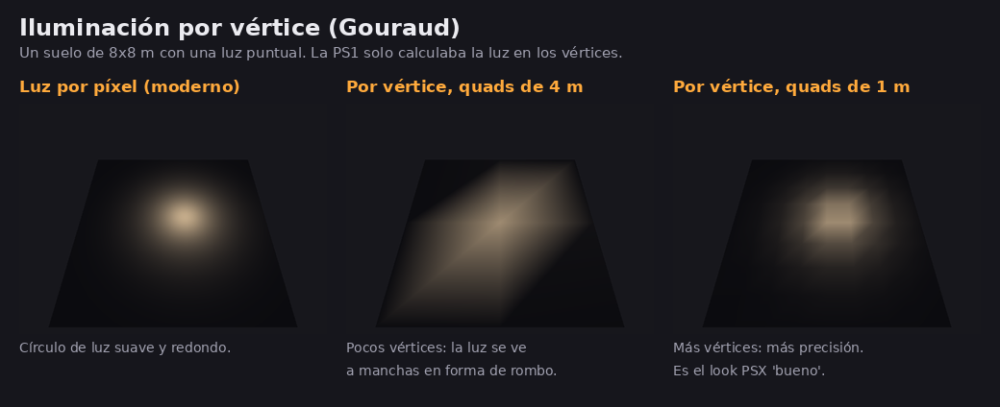
- **El detalle va en la textura, no en la geometría**.

### Flujo en Blender
1. Modela (modo Edit: `E` extruir, `Ctrl+R` loop cut, `I` inset).
2. Shading → **Flat** o Auto Smooth según la pieza.
3. UV: `U → Smart UV Project` para empezar, luego **Mark Seam** + Unwrap para hacerlo bien.
   Aprovecha al máximo el espacio del atlas.
4. Opcional: **Vertex Paint** para meter sombras/colores sin coste (el shader los usa con
   "Usar color de vértice").
5. Exporta como **FBX**: Apply Scalings → *FBX All*, Forward *-Z Forward*, Up *Y Up*,
   marca *Apply Transform*.

### En Unity, importación del modelo
- Scale Factor 1, **Normals: Calculate** o Import, y en Materials asigna tu material PSX.

### Ejercicios
1. Una caja de munición (12 triángulos).
2. Una pistola (≈300 tris).
3. Un enemigo humanoide por piezas (≈500 tris).
4. Un pasillo modular de 2×2×3 m con suelo subdividido.

---

## Fase 3 — Texturizado

### Tamaños y formato
- **64×64** props pequeños, **128×128** armas y enemigos, **256×256** máximo para lo importante.
- Usa un **atlas**: una textura para todo el personaje.

### Ajustes de importación en Unity (cada textura)
- **Filter Mode: Point (no filter)**  ← lo más importante
- **Compression: None** (la compresión mete artefactos que no son PSX)
- **Generate Mip Maps**: desactivado para lo cercano; puedes dejarlo en suelos lejanos para
  evitar ruido.
- **Max Size**: igual al tamaño real.

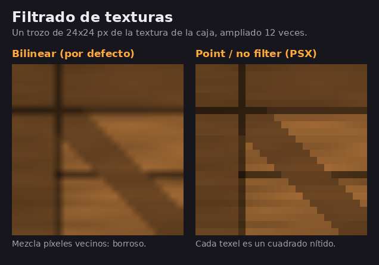

> Truco: el shader `PSX/Lit` ya fuerza filtrado Point con `sampler_PointRepeat`, pero
> configúralo en la importación también para que el editor muestre lo mismo.

### Cómo crear las texturas
**Opción A — desde fotos (el método de la época):**
1. Busca fotos libres de derechos (texturas de muros, metal, etc. en sitios CC0).
2. En GIMP/Krita/Photoshop: recorta, haz tileable (Filtro → Mapa → Hacer sin costuras).
3. Reduce a 128×128 (o 64×64) con interpolación **Ninguna** o **Lineal** y ajusta contraste.
4. **Reduce la paleta**: Imagen → Modo → Indexado, 16–64 colores (con o sin dithering).
5. Repinta a mano los píxeles que queden feos.

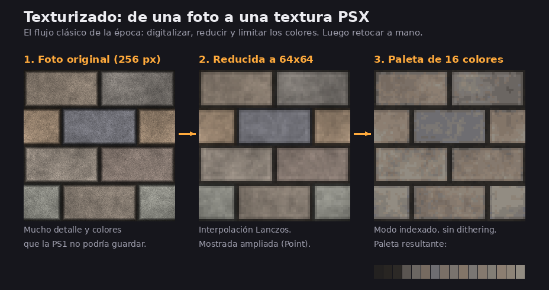

**Opción B — pixel art a mano** (Aseprite, LibreSprite gratis, Krita):
- Empieza con una paleta de 16–32 colores (Lospec.com tiene muchas).
- Pinta luces y sombras a mano: como la luz por vértice es pobre, la textura "hornea" el volumen.

**Opción C — pintar sobre el modelo** en Blender (Texture Paint) a baja resolución,
y luego reducir la paleta como en la opción A.

### Recortes con transparencia
Rejas, hojas, pelo: textura PNG con alfa, y en el material activa **Alpha Test**.
Nada de transparencia suave: la PS1 hacía recortes binarios.

---

## Fase 4 — Shaders (`Assets/Shaders/PSX_Lit.shader`)

Lee el shader de arriba abajo: está comentado en español. Este es el recorrido de cada vértice
dentro del shader:

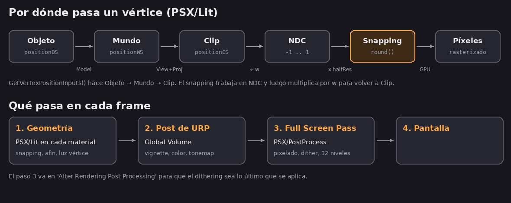

Conceptos que aprenderás:

1. **Estructura de un shader URP**: `Properties` → `SubShader` → `Pass` → `HLSLPROGRAM`.
2. **Vertex vs fragment**: el vertex shader se ejecuta por vértice (posición, luz),
   el fragment por píxel (color final).
3. **Espacios de coordenadas**: object → world → clip → NDC (pantalla en -1..1).
4. **Vertex snapping**: `round(ndc * halfRes) / halfRes`. Prueba a bajar `_SnapResolution`
   a (160,120) y mira cómo tiembla más.

   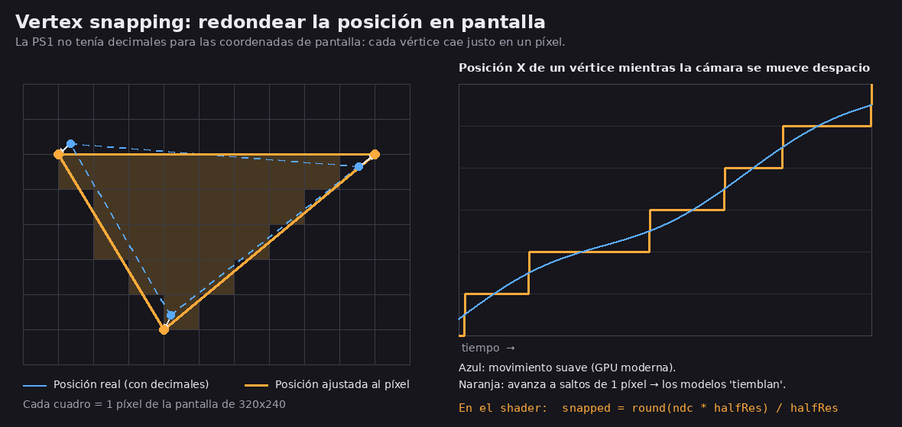

   En movimiento (fíjate en los bordes de la caja y de las baldosas):

   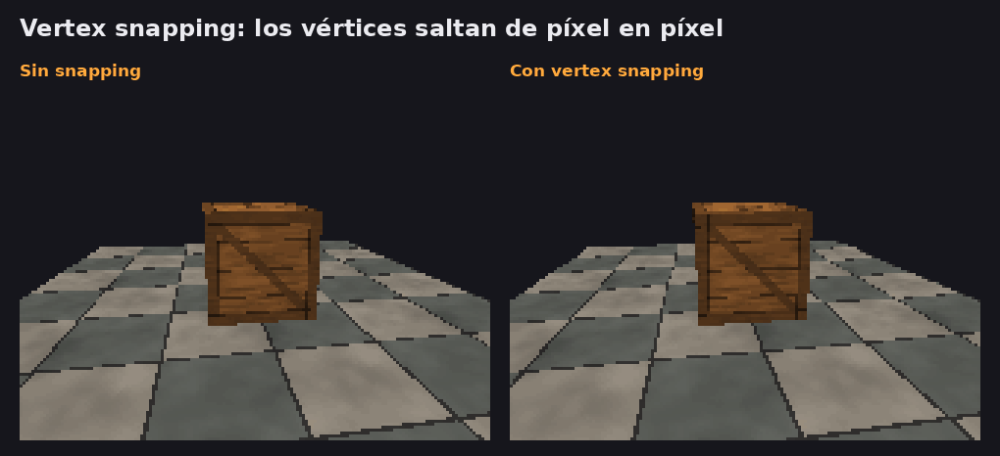

5. **Mapeado afín**: multiplicar UV por `w` en el vértice y dividir en el fragment.
   Pon `Deformacion afin` a 0 y a 1 mirando un suelo de cerca para ver la diferencia.

   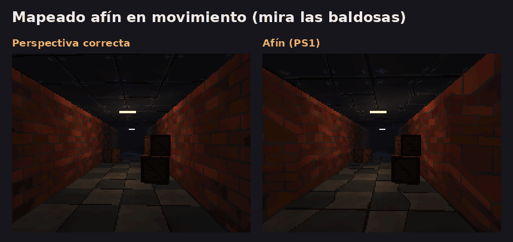

6. **Iluminación Lambert por vértice**: `dot(normal, dirLuz)`.
7. **SRP Batcher**: por qué todas las propiedades van dentro de `CBUFFER_START(UnityPerMaterial)`.

### Ejercicios de shaders
- Añade una propiedad `_Emission` (color) que se sume a la luz → para luces de neón y pantallas.
- Haz que `_SnapResolution` sea **global**: cámbialo a `float4 _PSXSnapResolution;` fuera del
  CBUFFER y ponlo desde C# con `Shader.SetGlobalVector("_PSXSnapResolution", ...)`.
- Haz un shader `PSX/Unlit` (sin luz) para el cielo y para sprites de efectos.
- Prueba a recrear `PSX/Lit` en **Shader Graph** (Custom Function node para el snapping):
  así ves las dos formas de hacer shaders en Unity.

---

## Fase 5 — Postprocesado (`Assets/Shaders/PSX_PostProcess.shader`)

### Montaje
1. Crea un material con el shader **PSX/PostProcess**.
2. Selecciona tu **Universal Renderer Data** → **Add Renderer Feature → Full Screen Pass Renderer Feature**.
3. Configúralo:
   - **Pass Material**: tu material
   - **Injection Point**: *After Rendering Post Processing*
   - **Requirements**: *Color*
4. Dale al Play. Ajusta en el material:
   - Resolución virtual (320,240) — o (320,180) si juegas en 16:9
   - Niveles de color: 32 = 15 bits auténticos; 16 o 8 para algo más extremo
   - Dithering: 1

### Qué hace cada parámetro

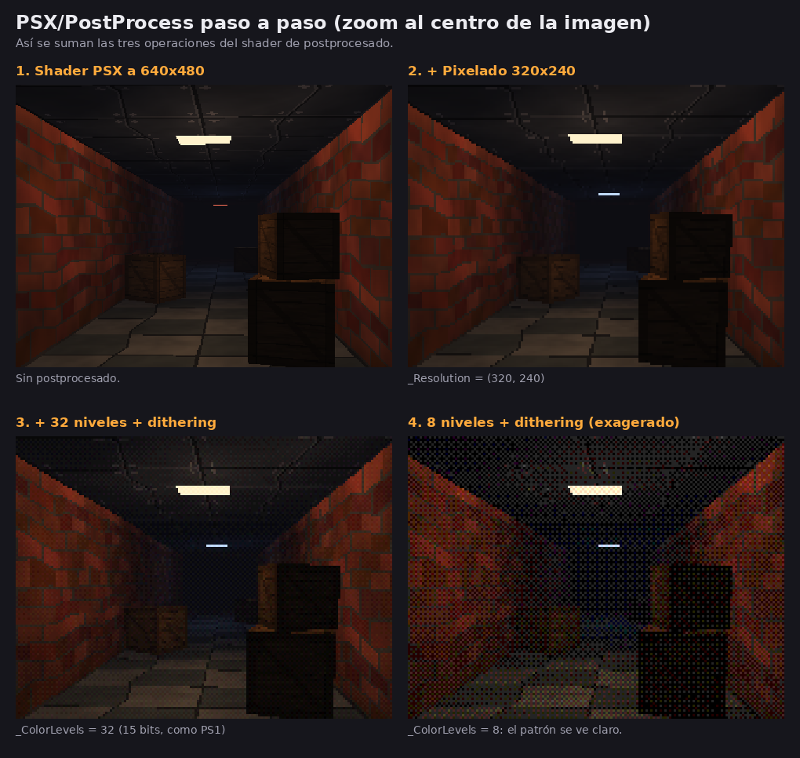

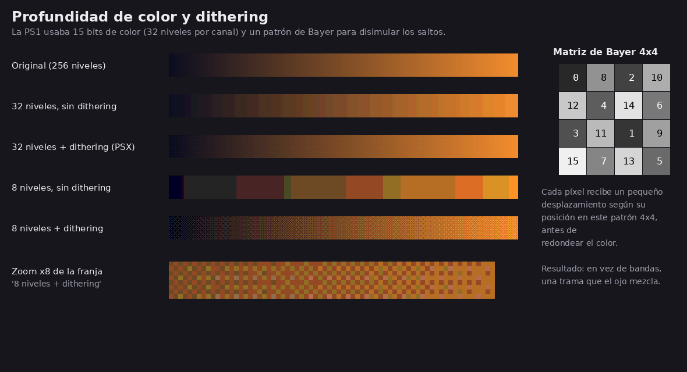

### Lo que aprenderás
- Qué es un **Renderer Feature** y en qué punto del frame se inyecta.
- **Pixelado** con UVs cuantizadas.
- **Dithering ordenado** con matriz de Bayer.
- Por qué cuantizar en **sRGB** y no en lineal.

### Postprocesado estándar de URP (Volume) que combina bien
Crea un **Global Volume** (GameObject → Volume → Global Volume) y añade:
- **Tonemapping**: None (o Neutral si se ve quemado)
- **Color Adjustments**: bajar algo la saturación, subir el contraste
- **Vignette**: 0.3, para el ambiente
- **Film Grain**: muy poco, opcional
- Nada de Bloom fuerte ni Motion Blur: no son de la época.

> Para más rendimiento (y autenticidad): en vez de pixelar en post, puedes renderizar la
> cámara a una **Render Texture** de 320×240 con Filter Point y mostrarla en una RawImage a
> pantalla completa. Buen ejercicio una vez entiendas el método de post.

---

## Fase 6 — Gameplay (`Assets/Scripts/`)

### Montaje del jugador
```
Player            (CharacterController, FPSController, Health)
 └─ Camera        (posición local 0, 1.6, 0; FOV 70–90; Near Clip 0.05)
     └─ Weapon    (HitscanWeapon, AudioSource)
         ├─ ModeloArma
         └─ MuzzleFlash (Point Light, rango 3, intensidad alta, color naranja)
```
- En `FPSController` arrastra la Camera a `cameraPivot`.
- Requiere el paquete **Input System** (viene en Unity 6; en 2022 instálalo desde Package Manager).

### Enemigo
`Capsule` o tu modelo + `Health` + `SimpleEnemy` + Collider. Dispárale.

### Siguientes pasos de gameplay (en este orden)
1. HUD con munición y vida (Canvas, fuente pixelada, sin antialiasing).
2. Recarga y munición limitada.
3. Enemigos con **NavMesh** (paquete AI Navigation) y que disparen.
4. Animaciones del arma (Animator) y de enemigos.
5. Puertas, llaves, pickups de vida y munición.
6. Un nivel completo pequeño con principio y final.

### Truco para el arma en primera persona
Para que el arma no atraviese paredes: pon el arma en una capa `Weapon`, y en el Universal
Renderer Data usa un **Render Objects** feature que la dibuje después con la profundidad limpia,
o usa una segunda cámara apilada (Camera Stacking).

---

## Fase 7 — Audio (no lo olvides, es medio estilo)
- Convierte sonidos a **22050 Hz**, mono, y en Unity: Load Type *Decompress On Load*,
  Compression *ADPCM* o *PCM*.
- Reverb Zones en salas grandes (la PS1 tenía reverb por hardware y se usaba mucho).
- Música: secuenciada/sample-based (trackers como OpenMPT o Furnace).

---

## Checklist del "look PSX"
- [ ] Todas las texturas en Point, sin compresión, ≤256 px
- [ ] Todos los materiales con `PSX/Lit`
- [ ] Suelos y paredes grandes subdivididos
- [ ] Niebla activada y color de fondo igual a la niebla
- [ ] Full Screen Pass con `PSX/PostProcess`
- [ ] MSAA y HDR desactivados
- [ ] Sin sombras en tiempo real (Light → Shadow Type: No Shadows)
- [ ] Sonidos a 22 kHz

## Recursos para seguir
- Documentación de URP: "Writing custom shaders" y "Full Screen Pass Renderer Feature".
- *The Book of Shaders* (gratis, para entender los fragment shaders).
- Comunidad **Haunted PS1** (itch.io) para inspiración y assets.
- Lospec.com para paletas de color.
